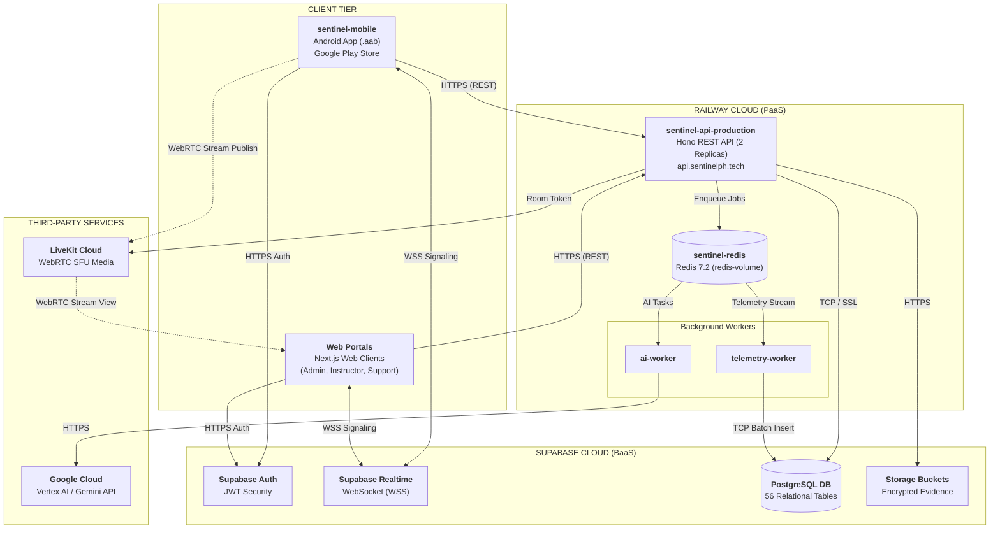

# Deployment Plan

This section presents the deployment plan for the **Sentinel** examination and proctoring platform. Building upon the physical compute, server hardware allocations (Section 3.1.2), and network bandwidth protocols (Section 3.1.3), the platform employs a cloud-native hosting strategy. The system decouples client presentation interfaces from server processing, background workers, and managed cloud infrastructure to ensure zero-downtime availability, low latency, and high exam integrity.

---

## 1. Additional Deployment Requirements (Third-Party Applications and Cloud Services)

To operate reliably without requiring expensive on-premise physical servers, Sentinel utilizes managed third-party cloud platforms and distribution services. Table 5 outlines the specific providers, service categories, hosted components, and their operational roles in the deployment architecture.

**Table 5**  
*Additional Deployment Requirements (Third-Party Applications and Cloud Services)*

| Third-Party Provider | Service Category | Hosted Component(s) | Deployment Purpose & Operational Role |
| :--- | :--- | :--- | :--- |
| **Railway** | Platform-as-a-Service (PaaS) | • `sentinel-api-production` • `sentinel-redis` • `telemetry-worker` • `ai-worker` | Hosts the containerized Node.js 22 REST API engine (`api.sentinelph.tech`) across 2 active replicas, an in-memory Redis 7.2 message broker with attached persistent storage (`redis-volume`), and background daemons for asynchronous telemetry batching and AI question generation. |
| **Supabase** | Backend-as-a-Service (BaaS) | • PostgreSQL Database • Supabase Auth • Supabase Storage • Supabase Realtime | Manages all 56 relational tables, user authentication via cryptographically signed JWTs with dynamic RBAC, private S3-compatible storage buckets (`exam-assets`, `incident-evidence`, `pdf-exports`), and persistent WebSockets for live exam status and inspection signaling. |
| **LiveKit Cloud** | WebRTC Media Server (SFU) | • Live Video Inspection SFU | Provides Selective Forwarding Unit infrastructure for low-latency live video streaming over WebRTC (DTLS-SRTP, 1.0–2.5 Mbps). Operates on-demand to stream student camera feeds only when an instructor actively inspects a session. |
| **Google Cloud** | Generative AI Cloud Platform | • Vertex AI / Gemini API | Provides foundation models interfaced by `ai-worker` to automatically draft exam questions from instructor-uploaded syllabi and Table of Specifications (TOS) documents. |
| **Google Play Console & EAS** | Mobile Application Distribution | • `sentinel-mobile` (`.aab` package) | Expo Application Services (EAS) compiles the React Native client into signed Android App Bundles (`.aab`). Google Play Console manages internal testing tracks and distributes the locked kiosk examination app to student Android devices. |

---

## 2. Deployment Diagram

Figure 10 illustrates the distribution of Sentinel's software artifacts across user client devices, Railway container services, Supabase platform infrastructure, and external cloud services.

  <b>Figure 10</b> 
  <i>Deployment Diagram of the Sentinel Examination Platform</i>

---

## 3. Description of the Deployment Diagram Illustration

Figure 10 divides the production deployment of Sentinel into four interconnected tiers:

1. **Client Tier**: Consists of the student Android application (`sentinel-mobile`) distributed via the Google Play Store, and web portals (`sentinel-core`, `sentinel-web`, `sentinel-support`) accessed through desktop browsers. Clients communicate with the backend via HTTPS and maintain lightweight WebSocket connections for instant signaling.
2. **Railway Cloud Tier**: Hosts the server-side containers. The central REST API (`sentinel-api-production`) runs with two active replicas behind Cloudflare to balance inbound client requests. High-frequency operations are offloaded to `sentinel-redis`. Background daemons consume these queues: `telemetry-worker` batches proctoring telemetry into PostgreSQL, while `ai-worker` processes asynchronous question generation.
3. **Supabase Cloud Tier**: Acts as the centralized persistence and authentication layer. It manages user authentication via JWT, persistent relational data across 56 tables, secure file storage for incident screenshots, and real-time state synchronization via WebSockets.
4. **Third-Party Services Tier**: LiveKit Cloud manages live video forwarding without passing media traffic through the primary API. Google Cloud Vertex AI handles generative question authoring from uploaded syllabi and Table of Specifications (TOS) documents.

---

## 4. Procedure to Deploy the Developed System

The systematic deployment of the Sentinel platform follows five sequential steps designed to guarantee zero-downtime availability, reproducible environment provisioning, and cryptographic security across all system tiers. Table 6 outlines the step sequence, deployment phase, target infrastructure, execution actions with exact commands, and the required verification checkpoints governing production release.

**Table 6**  
*Procedure to Deploy the Developed System*

| Step No. | Deployment Phase & Target Infrastructure | Implementation Actions & Execution Commands | Target Output & Verification Checkpoint |
| :---: | :--- | :--- | :--- |
| **Step 1** | **Database & Platform Setup** *(Supabase BaaS)* | 1. Provision a production project in the Supabase Cloud dashboard. 2. Retrieve connection strings: pooled (`DATABASE_URL`, port 6543) and direct (`DIRECT_URL`, port 5432). 3. Create private storage buckets: `exam-assets`, `incident-evidence`, and `pdf-exports` with Row Level Security (RLS). 4. Execute database schema migrations and baseline seeds from the repository: `pnpm run db:migrate && pnpm run db:seed:support` | • PostgreSQL 15 initialized with 56 relational tables. • Private storage buckets active with signed URL policies. • Core RBAC roles and default support templates seeded. |
| **Step 2** | **Third-Party Cloud Services** *(LiveKit & Google Cloud)* | 1. **LiveKit Cloud**: Create project at `cloud.livekit.io` and generate API credentials (`LIVEKIT_URL`, `LIVEKIT_API_KEY`, `LIVEKIT_API_SECRET`). 2. **Google Cloud Platform**: Enable Vertex AI API in Google Cloud Console and generate a service account credential key (`GEMINI_API_KEY`) for AI-assisted question synthesis. | • WebRTC SFU media gateway operational (1.0–2.5 Mbps per active stream). • Vertex AI API authenticated for asynchronous queue workers. |
| **Step 3** | **Backend & Worker Deployment** *(Railway PaaS)* | 1. Initialize `sentinel-api` project in Railway under the `production` environment. 2. Deploy `sentinel-redis` with attached persistent storage (`redis-volume`). 3. Deploy `sentinel-api-production` linked to GitHub: set root directory to `app/sentinel-api`, startup command to `pnpm run start`, bind environment variables, assign custom domain `api.sentinelph.tech`, and scale to 2 active replicas. 4. Deploy background daemons: `telemetry-worker` (`pnpm run start:telemetry-worker`) and `ai-worker` (`pnpm run start:ai-worker`). | • Node.js 22 Hono REST API online across 2 active replicas. • In-memory Redis 7.2 broker active with persistent state storage. • Background daemons actively consuming Redis queue streams. |
| **Step 4** | **Client Applications Distribution** *(Cloud Edge & EAS/Play Store)* | 1. **Web Portals** (`sentinel-web`, `sentinel-core`, `sentinel-support`): Configure production environment variables pointing to `https://api.sentinelph.tech` and deploy Next.js bundles to cloud edge hosting. 2. **Mobile Application** (`sentinel-mobile`):    a. Compile signed Android App Bundle (`.aab`):       `cd app/sentinel-mobile && eas build --platform android --profile production`    b. Submit compiled package to Google Play Console:       `eas submit --platform android --profile production` | • Next.js web portals globally accessible over HTTPS with edge caching. • Production-signed `.aab` successfully submitted to Google Play Console. • Mobile kiosk lockdown security controls (`FLAG_SECURE`) verified. |
| **Step 5** | **Post-Deployment Smoke Verification** *(Operational Audit)* | 1. **API Health Check**: Query `GET https://api.sentinelph.tech/health` to confirm HTTP 200 OK status. 2. **Authentication Test**: Sign in through `sentinel-web` to confirm GoTrue JWT session issuance and RBAC permission resolution. 3. **Service Monitoring**: Inspect Railway dashboard to ensure `sentinel-api-production` (2 replicas), `sentinel-redis`, `telemetry-worker`, and `ai-worker` display Online status. 4. **Live Proctoring Audit**: Initiate exam attempt on `sentinel-mobile`, trigger live inspection from `sentinel-web`, and confirm low-latency WebRTC video rendering through LiveKit. | • Zero critical startup exceptions recorded in Railway deployment logs. • End-to-end communication confirmed across Mobile, REST API, Redis, Supabase, and LiveKit SFU. • System certified operational for academic examination delivery. |

Structuring the deployment procedure into dedicated, verifiable stages ensures that infrastructure prerequisites are strictly validated prior to application service initialization. Decoupling database provisioning (Step 1) and external communication tokens (Step 2) from containerized compute execution (Step 3) eliminates circular dependencies during continuous integration and deployment. Furthermore, isolating client bundle distribution (Step 4) behind automated health audits (Step 5) guarantees that student examinees and faculty proctors interact exclusively with authenticated, high-performance platform endpoints.

