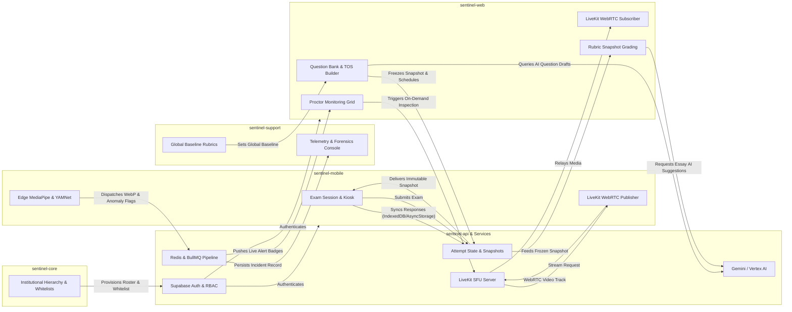

# Sentinel System: Functional Decomposition Diagrams (FDD)

> **Document Type:** Architectural & Functional Specification  
> **Target Scope:** Presentation Clients (`sentinel-mobile`, `sentinel-web`, `sentinel-core`, `sentinel-support`) & Supporting Backend Services  
> **Diagram Format:** Mermaid.js (Standard Flowcharts & Decomposition Trees)  
> **Source Baseline:** Monorepo commit `master`  

---

## 1. Executive Master Functional Decomposition

The Sentinel platform is structured as a hierarchical multi-client system designed for secure examination delivery, academic governance, and proctoring telemetry. The diagram below decomposes the platform from the root system (Level 0) into its four user-facing presentation applications and core backend services (Level 1), and further into their primary operational pillars (Level 2).

```mermaid
graph TD
    %% Root Level 0
    ROOT["<b>SENTINEL PLATFORM</b><br/>(Secure Digital Examination & Proctoring System)"]

    %% Level 1 Applications
    ROOT --> APP_MOB["<b>1.0 sentinel-mobile</b><br/>(Student Mobile Client - Expo / React Native)"]
    ROOT --> APP_WEB["<b>2.0 sentinel-web</b><br/>(Student & Instructor Web Portals - Next.js)"]
    ROOT --> APP_CORE["<b>3.0 sentinel-core</b><br/>(Institutional Administration - Next.js)"]
    ROOT --> APP_SUPP["<b>4.0 sentinel-support</b><br/>(System Support & Operations - Next.js)"]
    ROOT --> APP_API["<b>5.0 sentinel-api & Platform</b><br/>(Hono REST API & Cloud Services)"]

    %% Level 2 Pillars - Mobile
    APP_MOB --> MOB_AUTH["1.1 Auth & Onboarding"]
    APP_MOB --> MOB_ACAD["1.2 Academic Roster & Calendar"]
    APP_MOB --> MOB_CHECK["1.3 Pre-Exam Diagnostics & Calibration"]
    APP_MOB --> MOB_SESSION["1.4 Kiosk Examination Runtime"]
    APP_MOB --> MOB_TELEM["1.5 Edge Telemetry & LiveKit Inspection"]
    APP_MOB --> MOB_POST["1.6 Submission, Feedback & Support"]

    %% Level 2 Pillars - Web
    APP_WEB --> WEB_STUD["2.1 Student Examination Portal"]
    APP_WEB --> WEB_AUTH_EX["2.2 Assessment Authoring & TOS Matrix"]
    APP_WEB --> WEB_PROC["2.3 Real-Time Proctoring & Inspection"]
    APP_WEB --> WEB_EVAL["2.4 Rubric Grading & Exam Analytics"]

    %% Level 2 Pillars - Core
    APP_CORE --> CORE_ACAD["3.1 Institutional Hierarchy & Structure"]
    APP_CORE --> CORE_USER["3.2 Whitelist & Identity Provisioning"]
    APP_CORE --> CORE_EXAM["3.3 Campus Exam Oversight & Retiring"]
    APP_CORE --> CORE_AUDIT["3.4 Governance Analytics & Audit Logs"]

    %% Level 2 Pillars - Support
    APP_SUPP --> SUPP_BASE["4.1 Rubric Baselines & PDF Templates"]
    APP_SUPP --> SUPP_TELEM["4.2 Global Telemetry & Incident Audit"]
    APP_SUPP --> SUPP_HELP["4.3 User Helpdesk & Feedback Triage"]
    APP_SUPP --> SUPP_OPS["4.4 Tenant Controls & Service Health"]

    %% Level 2 Pillars - API & Platform
    APP_API --> API_FLOW["5.1 Exam Delivery & Attempt State Machine"]
    APP_API --> API_TELEM["5.2 Telemetry Ingestion & BullMQ Queue"]
    APP_API --> API_AI["5.3 AI Generation & Scoring Providers"]
    APP_API --> API_DATA["5.4 PostgreSQL, Storage & Realtime SFU"]

    %% Styling
    classDef rootStyle fill:#0f172a,stroke:#334155,stroke-width:3px,color:#ffffff,font-family:sans-serif,font-size:14px;
    classDef mobStyle fill:#0369a1,stroke:#0284c7,stroke-width:2px,color:#ffffff,font-family:sans-serif;
    classDef webStyle fill:#15803d,stroke:#16a34a,stroke-width:2px,color:#ffffff,font-family:sans-serif;
    classDef coreStyle fill:#6d28d9,stroke:#7c3aed,stroke-width:2px,color:#ffffff,font-family:sans-serif;
    classDef suppStyle fill:#b45309,stroke:#d97706,stroke-width:2px,color:#ffffff,font-family:sans-serif;
    classDef apiStyle fill:#334155,stroke:#475569,stroke-width:2px,color:#ffffff,font-family:sans-serif;

    classDef mobSub fill:#f0f9ff,stroke:#0284c7,stroke-width:1.5px,color:#0c4a6e;
    classDef webSub fill:#f0fdf4,stroke:#16a34a,stroke-width:1.5px,color:#14532d;
    classDef coreSub fill:#faf5ff,stroke:#7c3aed,stroke-width:1.5px,color:#4c1d95;
    classDef suppSub fill:#fffbeb,stroke:#d97706,stroke-width:1.5px,color:#78350f;
    classDef apiSub fill:#f8fafc,stroke:#64748b,stroke-width:1.5px,color:#1e293b;

    class ROOT rootStyle;
    class APP_MOB mobStyle;
    class APP_WEB webStyle;
    class APP_CORE coreStyle;
    class APP_SUPP suppStyle;
    class APP_API apiStyle;

    class MOB_AUTH,MOB_ACAD,MOB_CHECK,MOB_SESSION,MOB_TELEM,MOB_POST mobSub;
    class WEB_STUD,WEB_AUTH_EX,WEB_PROC,WEB_EVAL webSub;
    class CORE_ACAD,CORE_USER,CORE_EXAM,CORE_AUDIT coreSub;
    class SUPP_BASE,SUPP_TELEM,SUPP_HELP,SUPP_OPS suppSub;
    class API_FLOW,API_TELEM,API_AI,API_DATA apiSub;
```

---

## 2. Sentinel Mobile (`sentinel-mobile`) Functional Decomposition

The **Mobile Client** is dedicated to the student examination experience, engineered with offline resilience, kiosk-grade hardware restrictions, and on-device machine learning for anomaly detection.

```mermaid
graph TD
    MOB_ROOT["<b>sentinel-mobile</b><br/>(Student Mobile Application)"]

    %% Pillars
    MOB_ROOT --> M1["<b>1.0 Authentication & Onboarding</b>"]
    MOB_ROOT --> M2["<b>2.0 Academic Roster & Schedules</b>"]
    MOB_ROOT --> M3["<b>3.0 Pre-Exam Readiness Diagnostics</b>"]
    MOB_ROOT --> M4["<b>4.0 Kiosk-Locked Exam Runtime</b>"]
    MOB_ROOT --> M5["<b>5.0 Edge Telemetry & Media Stream</b>"]
    MOB_ROOT --> M6["<b>6.0 Post-Exam & Communication</b>"]

    %% M1 Functions
    M1 --> M1_1["1.1 Supabase Credentials / OAuth Sign-In"]
    M1 --> M1_2["1.2 Hardware SecureStore Token Caching"]
    M1 --> M1_3["1.3 Student Role Verification Guard"]
    M1 --> M1_4["1.4 Student Whitelist Claiming & Verification"]

    %% M2 Functions
    M2 --> M2_1["2.1 Enrolled Classroom Directory"]
    M2 --> M2_2["2.2 Multi-State Exam Cards (Upcoming/Past)"]
    M2 --> M2_3["2.3 Live Start-Time Countdown Timers"]
    M2 --> M2_4["2.4 Synchronized Assessment Calendar"]

    %% M3 Functions
    M3 --> M3_1["3.1 Anti-Cheat Policy & Privacy Consent"]
    M3 --> M3_2["3.2 Hardware Diagnostics (Cam, Mic, Ping)"]
    M3 --> M3_3["3.3 MediaPipe Face Mesh Baseline (EAR)"]
    M3 --> M3_4["3.4 Neutral Iris Coordinates Calibration"]
    M3 --> M3_5["3.5 Digital Exam Lobby & Realtime Admission"]

    %% M4 Functions
    M4 --> M4_1["4.1 Screen Capture & Recording Blocker"]
    M4 --> M4_2["4.2 AppState Backgrounding Interceptor"]
    M4 --> M4_3["4.3 Multi-Type Question Renderer & Drawer"]
    M4 --> M4_4["4.4 Local AsyncStorage Answer Buffering"]
    M4 --> M4_5["4.5 Resilient Reconnecting Auto-Sync"]

    %% M5 Functions
    M5 --> M5_1["5.1 Edge Gaze Deviation Detector (3s Window)"]
    M5 --> M5_2["5.2 YAMNet Acoustic Speech Classification"]
    M5 --> M5_3["5.3 Forensic WebP Evidence Frame Capture"]
    M5 --> M5_4["5.4 Batched Telemetry Ingestion Client"]
    M5 --> M5_5["5.5 On-Demand LiveKit WebRTC Camera Stream"]

    %% M6 Functions
    M6 --> M6_1["6.1 Confirmation & Timeout Auto-Submission"]
    M6 --> M6_2["6.2 Candidate Experience & Incident Feedback"]
    M6 --> M6_3["6.3 Score Summary & Benchmark Performance"]
    M6 --> M6_4["6.4 In-App Proctor Support Messaging"]

    %% Styling
    classDef rootNode fill:#0369a1,stroke:#075985,stroke-width:2px,color:#fff,font-weight:bold;
    classDef pillarNode fill:#e0f2fe,stroke:#0284c7,stroke-width:2px,color:#0369a1,font-weight:bold;
    classDef leafNode fill:#ffffff,stroke:#bae6fd,stroke-width:1px,color:#0f172a,font-size:12px;

    class MOB_ROOT rootNode;
    class M1,M2,M3,M4,M5,M6 pillarNode;
    class M1_1,M1_2,M1_3,M1_4,M2_1,M2_2,M2_3,M2_4,M3_1,M3_2,M3_3,M3_4,M3_5,M4_1,M4_2,M4_3,M4_4,M4_5,M5_1,M5_2,M5_3,M5_4,M5_5,M6_1,M6_2,M6_3,M6_4 leafNode;
```

### Mobile Functional Decomposition Detail

| Functional Module | Sub-Functions & Capabilities | Primary Implementation Reference |
| :--- | :--- | :--- |
| **Authentication & Onboarding** | • Supabase Auth JWT issuing • Expo SecureStore token persistence • Student whitelist verification by ID number & department • Student onboarding state routing | `app/(auth)/login.tsx` `app/(onboarding)/` `lib/auth/` |
| **Academic & Schedules** | • Enrolled classrooms & instructor details • Categorized assessment list with live countdowns • Synchronized calendar event grid | `app/(tabs)/classroom/` `app/(tabs)/exam/` `app/(tabs)/calendar.tsx` |
| **Diagnostics & Calibration** | • Hardware permission validation (Cam/Mic) • MediaPipe Face Mesh edge execution • 5-frame neutral EAR & iris offset baseline computation • Staging lobby with Supabase Realtime broadcast listener | `app/exam/[id]/checkup.tsx` `app/exam/[id]/lobby.tsx` `features/exam/hooks/calibration/` |
| **Kiosk Exam Runtime** | • `expo-screen-capture` OS screenshot prevention • `AppState` change listener for backgrounding detection • Multi-select, MCQ, and Essay question inputs • AsyncStorage local buffer and resilient sync adapter | `app/exam/[id]/session.tsx` `features/exam/hooks/security/` `features/exam/hooks/sync/` |
| **Edge Telemetry & Streaming** | • 500ms MediaPipe face presence & gaze deviation runner • 16kHz headless YAMNet speech classification worker • Forensic WebP incident frame snapshot creator • LiveKit SFU WebRTC front-camera stream publisher | `features/exam/hooks/monitoring/` `features/exam/hooks/live-inspection/` `mobile-live-inspection-bridge.tsx` |
| **Submission & Communication** | • Exam completion modal & expiration auto-submit • User experience rating & incident contestation notes • Objective scoring results presentation • Emergency proctor chat & course conversation threads | `app/exam/[id]/feedback.tsx` `app/exam/[id]/result.tsx` `app/(tabs)/messages.tsx` |

---

## 3. Sentinel Web (`sentinel-web`) Functional Decomposition

The **Web Application** serves dual primary actors: **Students** taking assessments via modern web browsers, and **Instructors** authoring questions, structuring exams via Table of Specifications (TOS), supervising live candidates, and grading essays.

```mermaid
graph TD
    WEB_ROOT["<b>sentinel-web</b><br/>(Student & Instructor Web Client)"]

    %% Portals
    WEB_ROOT --> SP["<b>1.0 Student Web Subsystem</b>"]
    WEB_ROOT --> IP["<b>2.0 Instructor Web Subsystem</b>"]

    %% Student Branches
    SP --> S1["1.1 Identity & Enrolled Courses"]
    SP --> S2["1.2 Browser Pre-Flight & Calibration"]
    SP --> S3["1.3 Fullscreen Examination Session"]
    SP --> S4["1.4 Results Archive & Messaging"]

    S1 --> S1_1["Student Whitelist Registration"]
    S1 --> S1_2["Enrolled Classrooms & Announcements"]
    S2 --> S2_1["Peripheral Diagnostics & Ping Test"]
    S2 --> S2_2["MediaPipe Web Worker Iris Calibration"]
    S2 --> S2_3["Live Waiting Room & Realtime Admission"]
    S3 --> S3_1["Fullscreen Lockdown & Tab Focus Guard"]
    S3 --> S3_2["Periodic 15s Answer Sync & IndexedDB Buffer"]
    S3 --> S3_3["Client YAMNet & FaceMesh Telemetry Alerts"]
    S4 --> S4_1["Detailed Scorecard & Rubric Breakdown"]
    S4 --> S4_2["Instructor / Proctor Realtime Messaging"]

    %% Instructor Branches
    IP --> I1["2.1 Question Bank & TOS Matrix"]
    IP --> I2["2.2 AI Question Item Generator"]
    IP --> I3["2.3 Exam Builder & Policy Configuration"]
    IP --> I4["2.4 Live Proctoring & Inspection Console"]
    IP --> I5["2.5 Grading Center & Performance Analytics"]

    I1 --> I1_1["Question Authoring by Bloom's Taxonomy"]
    I1 --> I1_2["2-Way Table of Specifications (TOS) Grid"]
    I1 --> I1_3["Question Exposure Limit Tracking & Retirement"]
    I2 --> I2_1["PDF Syllabus / Topic Context Ingestion"]
    I2 --> I2_2["Vertex AI / Gemini JSON Item Generation"]
    I2 --> I2_3["Draft Preview, Schema Validation & Commit"]
    I3 --> I3_1["Proctoring Policies (Gaze, Absence, Speech)"]
    I3 --> I3_2["Assessment Sectioning & Question Assignment"]
    I3 --> I3_3["Roster Scheduling & Exam Publishing"]
    I4 --> I4_1["Lobby Admission Roster (Admit All / Selective)"]
    I4 --> I4_2["Candidate Card Grid with Live Anomaly Badges"]
    I4 --> I4_3["On-Demand LiveKit SFU Video Inspection"]
    I4 --> I4_4["Forensic WebP Snapshot Evidence Review"]
    I5 --> I5_1["Frozen Snapshot Rubric Evaluation"]
    I5 --> I5_2["AI-Assisted Essay Score Suggestion (Gemini)"]
    I5 --> I5_3["Item Difficulty (P-Value) Discrimination"]
    I5 --> I5_4["Export Grade Roster (CSV) & Audit Sheet (PDF)"]

    %% Styling
    classDef rootNode fill:#15803d,stroke:#166534,stroke-width:2px,color:#fff,font-weight:bold;
    classDef portalNode fill:#dcfce7,stroke:#16a34a,stroke-width:2px,color:#14532d,font-weight:bold;
    classDef branchNode fill:#f0fdf4,stroke:#86efac,stroke-width:1.5px,color:#166534,font-weight:bold;
    classDef leafNode fill:#ffffff,stroke:#bbf7d0,stroke-width:1px,color:#0f172a,font-size:12px;

    class WEB_ROOT rootNode;
    class SP,IP portalNode;
    class S1,S2,S3,S4,I1,I2,I3,I4,I5 branchNode;
    class S1_1,S1_2,S2_1,S2_2,S2_3,S3_1,S3_2,S3_3,S4_1,S4_2,I1_1,I1_2,I1_3,I2_1,I2_2,I2_3,I3_1,I3_2,I3_3,I4_1,I4_2,I4_3,I4_4,I5_1,I5_2,I5_3,I5_4 leafNode;
```

### Web Functional Decomposition Detail

| Actor Domain | Functional Module | Primary Operational Capabilities | Implementation Reference |
| :--- | :--- | :--- | :--- |
| **Student** | **Onboarding & Classes** | • Whitelist matching & department enrollment • Enrolled classroom roster & subject feed | `src/app/(protected)/onboarding/` `src/app/(protected)/student/classroom/` |
| **Student** | **Diagnostics & Session** | • Edge MediaPipe Iris calibration in Web Worker • Fullscreen lockdown & blur/focus monitoring • IndexedDB offline caching and 15-second sync | `src/app/(protected)/student/exam/` `src/workers/` `src/features/exams/` |
| **Instructor** | **Question Bank & TOS** | • Bloom's Taxonomy cognitive classification • Dynamic 2-way TOS percentage matrix balancing • Exposure threshold retirement (3-exam limit) | `src/app/(protected)/(instructor)/question/` `src/features/questions/` |
| **Instructor** | **AI Generation** | • Syllabus document staging & prompt injection • Structured JSON generation via Vertex/Gemini • Interactive review, editing, and question banking | `src/features/questions/components/` `app/sentinel-api/src/modules/integrations/gemini/` |
| **Instructor** | **Exam Builder** | • Multi-section assessment construction • Proctoring rule thresholds (Gaze, Absence, Speech) • Classroom assignment & delivery scheduling | `src/app/(protected)/(instructor)/exams/builder/` `src/features/exams/` |
| **Instructor** | **Live Proctoring** | • Exam lobby admission controls • Real-time candidate telemetry badge feed • On-demand LiveKit WebRTC video inspection • Forensic WebP incident snapshot verification | `src/app/(protected)/(instructor)/exams/monitor/` `src/lib/livekit/` |
| **Instructor** | **Grading & Analytics** | • Evaluation against immutable rubric snapshot • Gemini AI essay evaluation suggestions • Empirical Item Difficulty Index (P-value) • CSV grade export & PDF exam audit generation | `src/app/(protected)/(instructor)/exams/grading/` `src/app/(protected)/(instructor)/exams/reports/` |

---

## 4. Sentinel Core (`sentinel-core`) Functional Decomposition

The **Core Administrative Client** manages institutional hierarchy, academic programs, student whitelist authorization, academic term calendars, cross-campus examination oversight, and governance compliance.

```mermaid
graph TD
    CORE_ROOT["<b>sentinel-core</b><br/>(Institutional Administration & Academic Governance)"]

    %% Pillars
    CORE_ROOT --> C1["<b>1.0 Institutional Structure</b>"]
    CORE_ROOT --> C2["<b>2.0 Whitelist & Identity Provisioning</b>"]
    CORE_ROOT --> C3["<b>3.0 Academic Assessment Oversight</b>"]
    CORE_ROOT --> C4["<b>4.0 Governance, Auditing & Logs</b>"]

    %% C1 Functions
    C1 --> C1_1["1.1 Department & College Management"]
    C1 --> C1_2["1.2 Degree Program & Curriculum Catalog"]
    C1 --> C1_3["1.3 Academic Terms, Semesters & Timelines"]
    C1 --> C1_4["1.4 Physical Exam Rooms & Capacity Config"]
    C1 --> C1_5["1.5 Class Section Assignment & Course Offerings"]

    %% C2 Functions
    C2 --> C2_1["2.1 Student Whitelist CSV Bulk Ingestion"]
    C2 --> C2_2["2.2 Whitelist Claim Status & Discrepancy Audits"]
    C2 --> C2_3["2.3 Faculty & Instructor Roster Assignment"]
    C2 --> C2_4["2.4 Department Administrator Account Provisioning"]
    C2 --> C2_5["2.5 Dynamic RBAC Roles & Permission Overrides"]

    %% C3 Functions
    C3 --> C3_1["3.1 Campus-Wide Examination Directory"]
    C3 --> C3_2["3.2 Examination Schedule Conflict Detection"]
    C3 --> C3_3["3.3 Master Question Bank Oversight"]
    C3 --> C3_4["3.4 Question Exposure & Retirement Audits"]
    C3 --> C3_5["3.5 Institution-Wide Broadcast Announcements"]

    %% C4 Functions
    C4 --> C4_1["4.1 Departmental Performance & Pass Rates"]
    C4 --> C4_2["4.2 Cross-Campus Academic Integrity Analytics"]
    C4 --> C4_3["4.3 Security Event & Login Audit Logging"]
    C4 --> C4_4["4.4 Administrative Action Traceability Logs"]
    C4 --> C4_5["4.5 Accreditation Compliance Report Generation"]

    %% Styling
    classDef rootNode fill:#6d28d9,stroke:#5b21b6,stroke-width:2px,color:#fff,font-weight:bold;
    classDef pillarNode fill:#ede9fe,stroke:#7c3aed,stroke-width:2px,color:#4c1d95,font-weight:bold;
    classDef leafNode fill:#ffffff,stroke:#ddd6fe,stroke-width:1px,color:#0f172a,font-size:12px;

    class CORE_ROOT rootNode;
    class C1,C2,C3,C4 pillarNode;
    class C1_1,C1_2,C1_3,C1_4,C1_5,C2_1,C2_2,C2_3,C2_4,C2_5,C3_1,C3_2,C3_3,C3_4,C3_5,C4_1,C4_2,C4_3,C4_4,C4_5 leafNode;
```

### Core Functional Decomposition Detail

| Functional Pillar | Sub-Functions & Capabilities | Primary Implementation Reference |
| :--- | :--- | :--- |
| **Institutional Structure** | • Department creation and academic college mapping • Degree course cataloging (BSCS, BSIT, etc.) • Semester/term dates and active status flags • Room venue identification with seating limits • Class section generation linked to academic courses | `src/app/(protected)/(organization)/departments/` `src/app/(protected)/courses/` `src/app/(protected)/(organization)/semesters/` `src/app/(protected)/(organization)/rooms/` `src/app/(protected)/sections/` |
| **Whitelist & Identity** | • Multi-student CSV upload with automated parser • Matching student IDs against registered Supabase UIDs • Departmental teacher roster assignment • Administrative user role provisioning & granular RBAC | `src/app/(protected)/administrators/` `src/app/(protected)/classrooms/` `packages/db/prisma/schema.prisma` (`student_whitelist`) |
| **Assessment Oversight** | • Read-only inspection of campus-wide exams • Exam room & schedule time collision checker • Centralized question repository audit • Question usage counter and retirement verification | `src/app/(protected)/exams/` `src/app/(protected)/question/` `src/app/(protected)/announcements/` |
| **Auditing & Governance** | • Cross-departmental grade analytics and pass rates • Comprehensive proctoring violation incident trends • Detailed audit trail for user access and modifications • Exportable compliance data for academic boards | `src/app/(protected)/analytics/` `src/app/(protected)/logs/` `src/app/(protected)/guides/` |

---

## 5. Sentinel Support (`sentinel-support`) Functional Decomposition

The **Support Portal** provides technical operations, system-wide baseline governance, global telemetry monitoring, user issue triage, and multi-tenant operational configuration.

```mermaid
graph TD
    SUPP_ROOT["<b>sentinel-support</b><br/>(Support Operations & Platform Maintenance)"]

    %% Pillars
    SUPP_ROOT --> P1["<b>1.0 System Baselines & Governance</b>"]
    SUPP_ROOT --> P2["<b>2.0 Telemetry Monitoring & Forensics</b>"]
    SUPP_ROOT --> P3["<b>3.0 User Helpdesk & Feedback</b>"]
    SUPP_ROOT --> P4["<b>4.0 Operational Infrastructure Controls</b>"]

    %% P1 Functions
    P1 --> P1_1["1.1 Global Essay Baseline Rubrics (BASELINE Scope)"]
    P1 --> P1_2["1.2 Legacy Standard Rubric Safety Fallbacks"]
    P1 --> P1_3["1.3 Dynamic PDF Audit & Certificate Templates"]
    P1 --> P1_4["1.4 Default Proctoring Sensitivity Thresholds"]
    P1 --> P1_5["1.5 Multi-Institution Tenant Settings"]

    %% P2 Functions
    P2 --> P2_1["2.1 Real-Time Ingest Telemetry Stream Monitor"]
    P2 --> P2_2["2.2 Cross-Platform Forensic Evidence Viewer"]
    P2 --> P2_3["2.3 Disciplinary Evidence Package Generation"]
    P2 --> P2_4["2.4 Incident False-Positive Recalibration"]
    P2 --> P2_5["2.5 Secure Incident Evidence Bucket Management"]

    %% P3 Functions
    P3 --> P3_1["3.1 Candidate Experience Feedback Triage"]
    P3 --> P3_2["3.2 Exam Anomaly Contestation Ticket System"]
    P3 --> P3_3["3.3 Account Status Unlocking & Whitelist Repair"]
    P3 --> P3_4["3.4 Direct Operational User Messaging"]
    P3 --> P3_5["3.5 Standard Operating Procedure (SOP) Knowledge Base"]

    %% P4 Functions
    P4 --> P4_1["4.1 System Feature Flags & Maintenance Mode"]
    P4 --> P4_2["4.2 Service Health (Supabase, LiveKit, Gemini)"]
    P4 --> P4_3["4.3 BullMQ Asynchronous Task Queue Monitor"]
    P4 --> P4_4["4.4 API Transaction Metrics & Error Traces"]
    P4 --> P4_5["4.5 Scheduled Maintenance Calendar Announcements"]

    %% Styling
    classDef rootNode fill:#b45309,stroke:#92400e,stroke-width:2px,color:#fff,font-weight:bold;
    classDef pillarNode fill:#fef3c7,stroke:#d97706,stroke-width:2px,color:#78350f,font-weight:bold;
    classDef leafNode fill:#ffffff,stroke:#fde68a,stroke-width:1px,color:#0f172a,font-size:12px;

    class SUPP_ROOT rootNode;
    class P1,P2,P3,P4 pillarNode;
    class P1_1,P1_2,P1_3,P1_4,P1_5,P2_1,P2_2,P2_3,P2_4,P2_5,P3_1,P3_2,P3_3,P3_4,P3_5,P4_1,P4_2,P4_3,P4_4,P4_5 leafNode;
```

### Support Functional Decomposition Detail

| Operational Pillar | Sub-Functions & Capabilities | Primary Implementation Reference |
| :--- | :--- | :--- |
| **Baselines & Governance** | • Authoring and updating global baseline essay rubrics • Fallback mapping to legacy-standard-v1 rubrics • Dynamic PDF export template layout configuration • Global proctoring rule defaults and tenant rules | `src/app/(protected)/(support)/control/` `src/app/(protected)/(support)/pdf-templates/` `docs/capstone/architecture/system-overview.md` |
| **Telemetry & Forensics** | • System-wide telemetry stream inspection • High-resolution WebP snapshot viewer with metadata • Disciplinary evidence bundle export for formal boards • False positive classification & weight adjustment | `src/app/(protected)/(support)/telemetry/` `src/app/(protected)/logs/` |
| **Helpdesk & Feedback** | • Candidate rating inspection & usability triage • Student incident disputes and contestation appeals • Account state remediation (unblocking whitelist errors) • Direct operational support chat with students/faculty | `src/app/(protected)/feedbacks/` `src/app/(protected)/(support)/users/` `src/app/(protected)/messages/` |
| **Infrastructure Controls**| • Maintenance mode activation and feature toggle flags • Third-party provider uptime (Supabase, LiveKit, Google) • BullMQ telemetry & AI queue health monitoring • Global service announcement broadcasts | `src/app/(protected)/(support)/control/` `src/app/(protected)/dashboard/` `src/app/(protected)/calendar/` |

---

## 6. End-to-End System Functional Interaction Matrix

To clarify how functions interconnect across the mobile and web presentation layers and the backend API, the following matrix summarizes cross-subsystem functional dependencies:

---

## 7. Quality & Verification Characteristics

1. **Hierarchy & Traceability:** Every function in the decomposition maps directly to an existing controller, page, hook, or schema in the monorepo codebase (`app/sentinel-*` and `packages/*`).
2. **Readability & Simplicity:** Each diagram is scoped to a single subsystem with clear Level 1 through Level 3 parent-child hierarchies, standardized alphanumeric node IDs, and clean semantic color coding.
3. **Mermaid.js Conformance:** All diagrams utilize standard flowchart/graph syntax with escaped labels and validated quote delimiters to prevent syntax errors during automated rendering in documentation viewers, GitHub, or Obsidian.
