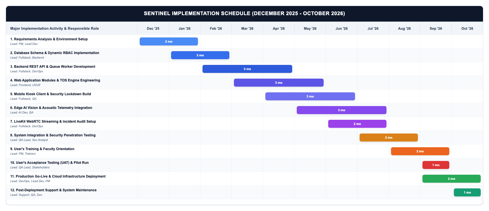
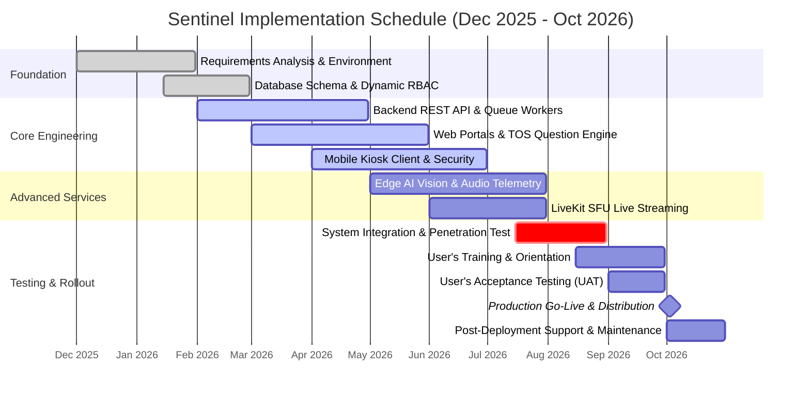
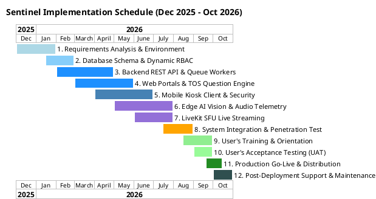

# Implementation Plan and Gantt Chart

## Implementation Plan

The implementation approach formulated for the Sentinel examination and proctoring platform employs a phased implementation strategy rather than an immediate "instant-on" (direct cutover or big-bang) cutover. Because Sentinel operates in a high-stakes academic assessment environment involving biometric identity verification, real-time edge artificial intelligence telemetry, and kiosk lockdown enforcement, an instantaneous changeover carries prohibitive institutional risks. An unexpected service degradation, uncalibrated acoustic threshold, or campus-wide network bottleneck during a live examination could severely disrupt scheduled testing, compromise academic integrity, and induce examinee panic. Consequently, a progressive, phased rollout provides the essential buffer to validate operational performance, calibrate ML detection sensitivities, train faculty proctors, and refine the student experience under controlled academic conditions.

The phased implementation roadmap is executed across three sequential stages: (1) Phase I: Pilot Deployment & Environmental Verification, wherein the platform is initially deployed exclusively within the College of Computer Studies (CCS) to test client compatibility, camera permissions, and local server responsiveness; (2) Phase II: Dual-Run Parallel Testing, where formative quizzes and mock exams are administered concurrently through Sentinel and conventional departmental methods without penalizing student grades, enabling the development team to benchmark server concurrency, calibrate WebRTC stream bandwidth, and fine-tune false-positive detection rates; and (3) Phase III: Institutional Cutover and University-Wide Production Handover, in which all academic departments transition to Sentinel for mid-term and final examinations following structured faculty orientation, institutional whitelist uploading, and administrative onboarding. This staged methodology ensures high availability, robust risk containment, and seamless organizational adaptation across all user tiers.

---

## Major Implementation Tasks

This phase includes the overall major plan for the system implementation. It contains the tasks that are required to accomplish from the beginning of the process until the deployment of the system to its actual clients and end-users. Table 10 details the major implementation activities, their technical operational descriptions, and the allocated responsible roles overseeing each deliverable.

### Table 10 Lists of Major Implementation Tasks

| Major Activities | Description | Responsible Person/Team |
| :--- | :--- | :--- |
| **Requirements Analysis & Environment Initialization** | Gathers functional, security, and institutional proctoring requirements from university stakeholders; configures monorepo infrastructure (pnpm, Turborepo), and provisions cloud staging environments. | Project Manager, Fullstack / Lead Developer |
| **Database Schema & Dynamic RBAC Implementation** | Formulates and executes 56-table relational schema migrations in Supabase PostgreSQL; integrates Kysely ORM type bindings, and establishes fine-grained Row Level Security (RLS) policies and custom JWT claims. | Fullstack / Lead Developer, Backend Engineer |
| **Backend REST API & Telemetry Pipeline Development** | Implements core Hono REST API endpoints; provisions in-memory Redis message queues with persistent storage, and builds background worker daemons (telemetry-worker and ai-worker) for asynchronous processing. | Fullstack / Lead Developer, DevOps Engineer |
| **Web Application Modules & TOS Engine Engineering** | Develops sentinel-web (instructor proctoring, exam builder, Bloom's TOS question banking) and sentinel-core (institutional governance, campus/college hierarchy, student whitelist batch onboarding). | Frontend & UI/UX Developer, Fullstack Developer |
| **Mobile Examination Client & Kiosk Lockdown Build** | Builds sentinel-mobile in React Native / Expo, engineering native Android lock-task kiosk security (FLAG_SECURE), offline AsyncStorage answer buffering, hardware diagnostics, and digital lobby synchronization. | Fullstack / Mobile Developer, QA Engineer |
| **Edge AI Vision & Acoustic Telemetry Integration** | Integrates client-side MediaPipe FaceMesh/Iris gaze tracking and TensorFlow.js YAMNet acoustic speech classification on dedicated Web Workers, capturing compressed WebP forensic frames during infractions. | AI / Fullstack Developer, QA Engineer |
| **LiveKit SFU WebRTC Streaming & Incident Audit Setup** | Integrates low-latency LiveKit SFU media gateway for on-demand live video inspection without recording; constructs chronological incident review feeds and dispute resolution tools in sentinel-support. | Fullstack Developer, Cloud / DevOps Engineer |
| **System Integration & Security Penetration Testing** | Executes end-to-end integration tests, high-volume telemetry stress tests on Redis/BullMQ, and penetration testing targeting kiosk bypasses, network disconnection resilience, and JWT token tampering. | Quality Assurance (QA) Lead, Security Analyst |
| **User's Training** | Conducts structured operational training sessions and workshops for faculty instructors, academic administrators, and student examinees; distributes role-specific user manuals, handbooks, and video tutorials. | Project Manager, Implementation Coordinator, Faculty Trainers |
| **User's Acceptance** | Administers formal User Acceptance Testing (UAT) and mock proctored exams with student and faculty cohorts in the pilot department, evaluating usability via standardized ISO 25010 and System Usability Scale (SUS) instruments. | QA Lead, Project Manager, Academic Stakeholders |
| **Go Live** | Executes production deployment: provisions live containerized PaaS services on Railway, submits signed Android App Bundles (.aab) to Google Play Console, binds production domains (sentinelph.tech), and initiates departmental cutover. | Fullstack / Lead Developer, Cloud / DevOps Engineer, Project Manager |
| **Support** | Delivers post-implementation warranty support: operates 24/7 technical incident triage, monitors Redis queue latency and database health metrics, executes automated daily backups, and patches operational defects. | Support Personnel, Lead Developer, QA Engineer |

---

## Implementation Timeline and Gantt Chart

To ensure systematic tracking and adherence to academic deadlines, the implementation roadmap is scheduled across an 11-month lifecycle spanning December 2025 through October 2026. Table 11 presents the fully customizable, table-based Gantt chart delineating the active duration of each major implementation task across all development, verification, training, and operational phases. Users may directly modify task durations, add milestones, or adjust scheduling blocks within this matrix.

### Table 11 Lists of Implementation Schedule Gantt Chart (December 2025 – October 2026)

| Major Implementation Activity | Dec '25 | Jan '26 | Feb '26 | Mar '26 | Apr '26 | May '26 | Jun '26 | Jul '26 | Aug '26 | Sep '26 | Oct '26 |
| :--- | :---: | :---: | :---: | :---: | :---: | :---: | :---: | :---: | :---: | :---: | :---: |
| 1. Requirements Analysis & Environment | █ | █ | | | | | | | | | |
| 2. Database Schema & Dynamic RBAC | | █ | █ | | | | | | | | |
| 3. Backend REST API & Queue Workers | | | █ | █ | █ | | | | | | |
| 4. Web Portals & TOS Question Engine | | | | █ | █ | █ | | | | | |
| 5. Mobile Kiosk Client & Security | | | | | █ | █ | █ | | | | |
| 6. Edge AI Vision & Audio Telemetry | | | | | | █ | █ | █ | | | |
| 7. LiveKit SFU Live Streaming | | | | | | | █ | █ | | | |
| 8. System Integration & Penetration Test | | | | | | | | █ | █ | | |
| 9. User's Training & Orientation | | | | | | | | | █ | █ | |
| 10. User's Acceptance Testing (UAT) | | | | | | | | | | █ | |
| 11. Production Go-Live & Distribution | | | | | | | | | | █ | █ |
| 12. Post-Deployment Support & Maintenance | | | | | | | | | | | █ |

*(Note: In the Microsoft Word document, each active cell is shaded with dark slate `#1E293B` and contains a centered indicator, allowing direct click-and-drag or cell-shading edits without third-party diagramming software).*

---

### Figure 11. Implementation Schedule Gantt Chart of the Sentinel Platform

Figure 11 visually illustrates the sequential alignment and overlapping milestones governing the Sentinel implementation lifecycle. Core foundational engineering—comprising requirements gathering, database architecture, and backend REST API construction—is concentrated in the initial four months (December 2025 to April 2026). Parallel development streams for web assessment modules, mobile kiosk lockdowns, and client-side AI telemetry occur mid-cycle (April 2026 to July 2026), ensuring sufficient lead time for rigorous system integration and security penetration auditing in August 2026. Finally, stakeholder-facing activities—user training, acceptance evaluations, and production cutover—conclude the cycle across September and October 2026, establishing a reliable, verified, and sustainable proctoring infrastructure ready for university-wide academic deployment.

---

### Editable Gantt Chart Source Codes

#### Mermaid Gantt Chart Specification

#### PlantUML Gantt Chart Specification

