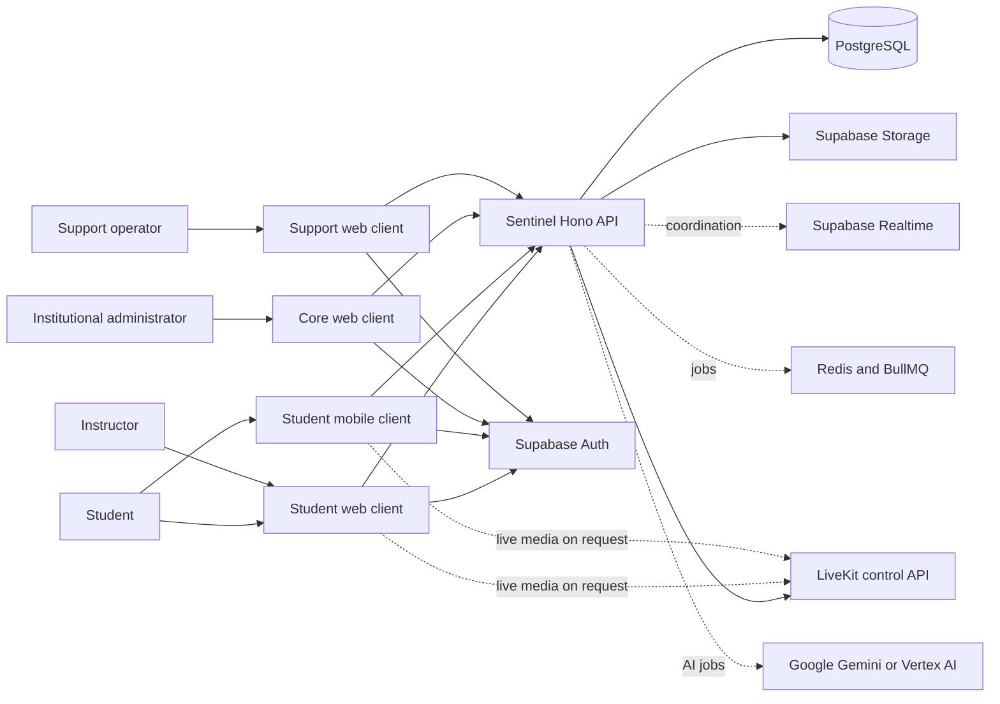
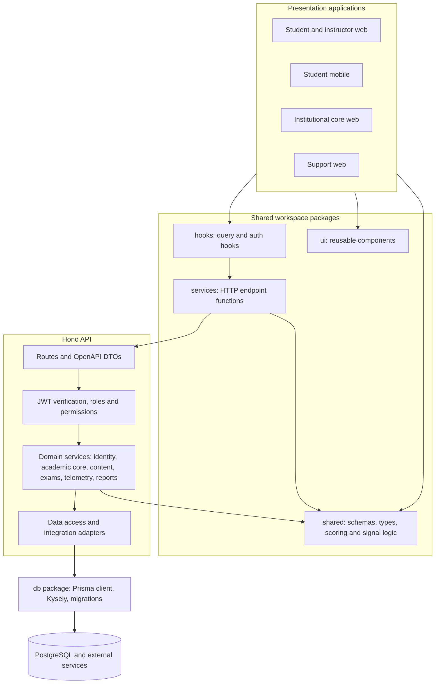
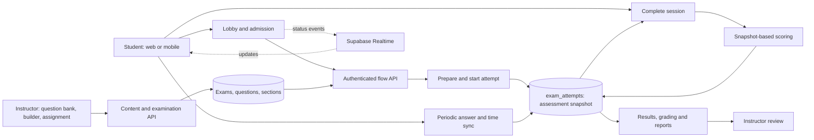
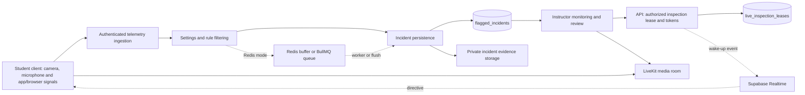
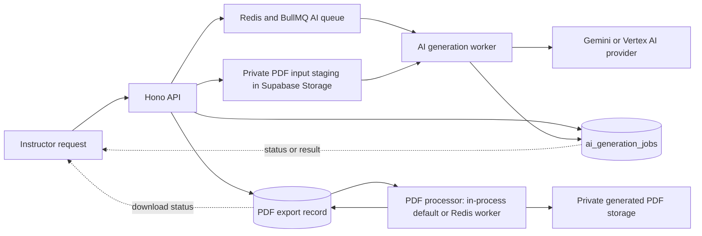

# Sentinel System Architecture

**Repository-based architecture review for the capstone manuscript**  
**Baseline:** `master` at commit `f24eafa4`, inspected 22 October 2026  
**Scope:** The Sentinel application monorepo (`app/` and `packages/`). The embedded `context-factory/` submodule is a development governance tool, not an application runtime component.

## Architectural Overview

Sentinel is a multi-client examination platform. The Next.js web applications separate student and instructor work (`sentinel-web`), institutional administration (`sentinel-core`), and support operations (`sentinel-support`). The Expo mobile application provides a student examination client. These clients use Supabase Auth sessions and a shared HTTP client to call the Hono API. The API implements identity, academic administration, assessment content, examination, telemetry, reporting, and integration modules. PostgreSQL is the durable record for exams, attempts, incidents, permissions, and jobs. Supabase Realtime carries live coordination events; Supabase Storage holds private uploaded inputs, incident evidence, and generated artifacts. Redis/BullMQ supports configured asynchronous work. LiveKit carries on-demand inspection media. Google's Gemini/Vertex AI integration supports question generation. These are logical code relationships; the review did not verify live cloud configuration or service health.

Figures 1–5 use the same visual progression: **external context → internal components → examination transaction → proctoring transaction → auxiliary jobs**. Solid arrows represent an implemented request, data, or media path. Dashed arrows denote configuration-dependent paths or event notification. The figures simplify implementation details to preserve the system boundary and trust relationships.

**Figure 1**  
*Sentinel System Context and External Services*

*Note.* The four web/mobile clients are distinct deployed applications in the source tree. Realtime is for event coordination; the inspection video path uses LiveKit. Redis is configuration dependent for telemetry and PDF generation, and is required by the production AI job mode. Based on `app/*/package.json`, `app/sentinel-api/src/app.ts`, `app/sentinel-api/src/server.ts`, and `app/sentinel-api/src/lib/gemini/gemini.provider.ts`.

Figure 1 sets the system boundary. Figure 2 opens the API and shared-code portion of that boundary.

**Figure 2**  
*Logical Components and Dependency Direction*

*Note.* The figure shows the dominant request path, not a claim that every module uses every layer. Some simple controllers call data access directly. `@sentinel/db` supplies Prisma and a Kysely extension over the same PostgreSQL pool. Based on `packages/*/package.json`, `packages/services/src/api-client.ts`, `app/sentinel-api/src/app.ts`, `app/sentinel-api/src/middleware/auth.ts`, and `packages/db/src/db.ts`.

Figure 2 identifies the reusable contracts and API modules. Figure 3 follows one examination through those components.

**Figure 3**  
*Examination Delivery and Attempt Persistence*

*Note.* `exam_attempts` stores an assessment snapshot, answer snapshot, score snapshot, and lifecycle state. The flow service rejects writes to completed or terminal attempts; completion persists scoring data and triggers notifications/calibration. Realtime coordinates lobby status but does not replace the database record. Based on `app/sentinel-api/src/modules/examination/flow/`, `app/sentinel-api/src/modules/examination/lobby/`, `app/sentinel-api/src/modules/examination/grading/`, and `packages/db/prisma/schema.prisma`.

Figure 3 covers assessment state. Figure 4 shows the separate monitoring path attached to an active attempt.

**Figure 4**  
*Proctoring Telemetry, Incident Review, and On-Demand Inspection*

*Note.* Sensor outputs are signals, not determinations of cheating. Telemetry may persist synchronously or via Redis/BullMQ according to settings. A restricted evidence-candidate path persists inline. The API authorizes inspection and stores a lease; Supabase Realtime prompts the student client, while LiveKit carries the camera stream. Based on `app/sentinel-api/src/modules/telemetry/`, `app/sentinel-api/src/modules/examination/live-inspection/`, `app/sentinel-mobile/features/exam/hooks/monitoring/`, and `packages/db/prisma/schema.prisma`.

Figure 4 separates control, evidence, and media. Figure 5 shows long-running content and report generation outside the main examination transaction.

**Figure 5**  
*Question Generation and PDF Export Processing*

*Note.* The AI API stages PDFs in a private Storage bucket before creating the database record and enqueuing a job. The worker downloads the manifest, calls the configured Google provider, and records status/result. In production, the AI queue requires Redis; development may use an in-memory runner. PDF generation defaults to in-process execution and uses a Redis worker only when configured. Based on `app/sentinel-api/src/modules/integrations/gemini/`, `app/sentinel-api/src/lib/gemini/`, and `app/sentinel-api/src/modules/general/pdf-documents/queue/`.

## Architectural Interpretation and Limits

The architecture separates the durable examination record from low-latency coordination and optional asynchronous processing. The API verifies Supabase-issued tokens and resolves permissions before protected operations. The database layer uses Prisma schema/migrations and a Kysely query client; private object storage holds uploaded or generated binary content. The code supports deployment as independently running API and worker processes, but source inspection does not establish which switches or services are active in the current production environment.

This review is a **static source review**, not a penetration test, load test, deployment audit, or validation of proctoring accuracy. It makes no claim that a flagged incident proves misconduct or that the system prevents every bypass. Untracked files present in the checkout were not treated as authoritative implementation evidence. The diagrams deliberately omit routine UI state, internal DTO variants, database columns outside the illustrated flows, and Context Factory's agent tooling.

## Source Evidence Index

| Architectural claim | Principal source paths |
|---|---|
| Application and package boundaries | `package.json`; `app/*/package.json`; `packages/*/package.json` |
| API route composition and middleware | `app/sentinel-api/src/app.ts`; `app/sentinel-api/src/middleware/auth.ts` |
| Client HTTP and session path | `packages/services/src/api-client.ts`; `app/sentinel-web/src/data/api/client.ts`; `app/sentinel-mobile/lib/api-client.ts` |
| Database and schema | `packages/db/src/db.ts`; `packages/db/src/create-db-client.ts`; `packages/db/prisma/schema.prisma` |
| Exam delivery and scoring | `app/sentinel-api/src/modules/examination/flow/`; `app/sentinel-api/src/modules/examination/grading/` |
| Telemetry and review | `app/sentinel-api/src/modules/telemetry/` |
| Inspection control and media | `app/sentinel-api/src/modules/examination/live-inspection/`; `app/sentinel-api/src/modules/infrastructure/livekit/` |
| AI and PDF jobs | `app/sentinel-api/src/modules/integrations/gemini/`; `app/sentinel-api/src/modules/general/pdf-documents/` |

## References

American Psychological Association. (2021). *Figure setup*. https://apastyle.apa.org/style-grammar-guidelines/tables-figures/figures

Sentinel development team. (2026). *Sentinel* [Computer software; unpublished source code, commit `f24eafa4`].

