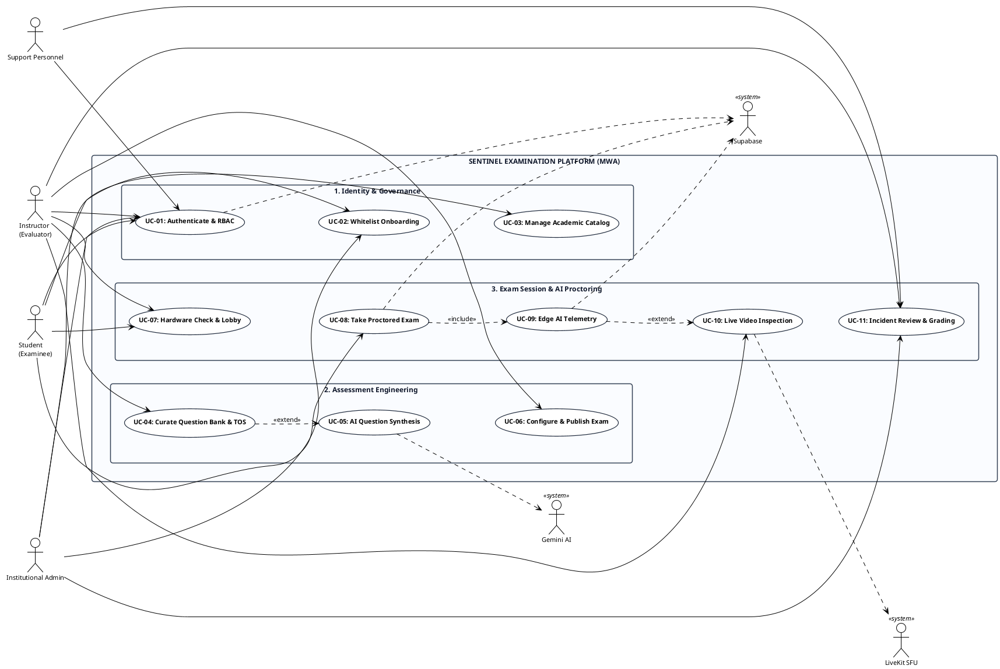
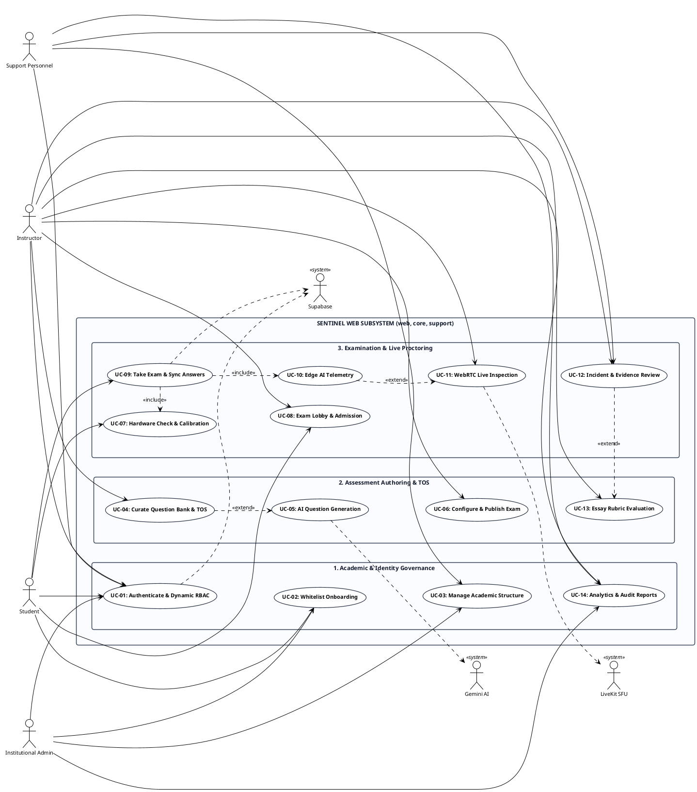
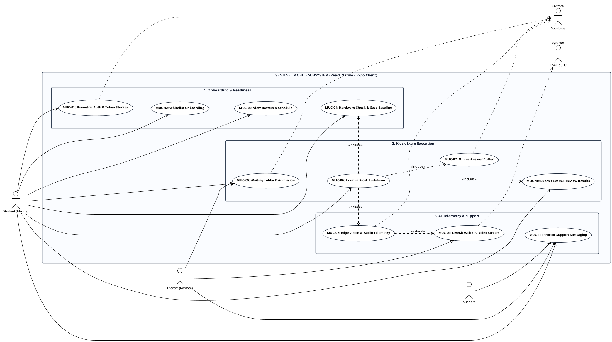

# Sentinel Examination Platform: Use Case Diagrams and Short Descriptions

> **Target Chapter:** Chapter 4 (4.2 Design of Software, Systems, Products and/or Processes)  
> **Section:** USE CASE DIAGRAMS & USE CASE NARRATIVES  
> **Classification:** MWA (Mobile and Web Applications)  
> **Generated Word Document:** [USE-CASE-DIAGRAMS-AND-DESCRIPTIONS.docx](file:///Applications/XAMPP/xamppfiles/htdocs/sentinel/docs/capstone/manuscript/USE-CASE-DIAGRAMS-AND-DESCRIPTIONS.docx)  
> **Visual Assets (PNG):**
> - [Figure 3 Master Use Case Diagram (PNG)](file:///Applications/XAMPP/xamppfiles/htdocs/sentinel/docs/capstone/diagrams/figure-3-sentinel-master-use-case-diagram.png)
> - [Figure 3a Web Use Case Diagram (PNG)](file:///Applications/XAMPP/xamppfiles/htdocs/sentinel/docs/capstone/diagrams/figure-3a-web-use-case-diagram.png)
> - [Figure 3b Mobile Use Case Diagram (PNG)](file:///Applications/XAMPP/xamppfiles/htdocs/sentinel/docs/capstone/diagrams/figure-3b-mobile-use-case-diagram.png)
> **PlantUML Sources (.puml):**
> - [Figure 3 Master PlantUML](file:///Applications/XAMPP/xamppfiles/htdocs/sentinel/docs/capstone/diagrams/figure-3-sentinel-master-use-case-diagram.puml)
> - [Figure 3a Web Subsystem PlantUML](file:///Applications/XAMPP/xamppfiles/htdocs/sentinel/docs/capstone/diagrams/figure-3a-web-use-case-diagram.puml)
> - [Figure 3b Mobile Subsystem PlantUML](file:///Applications/XAMPP/xamppfiles/htdocs/sentinel/docs/capstone/diagrams/figure-3b-mobile-use-case-diagram.puml)

---

## 4.2 DESIGN OF SOFTWARE, SYSTEMS, PRODUCTS AND/OR PROCESSES

This section presents the comprehensive design models and structural specifications formulated for the development of the Sentinel platform. It outlines the system’s functional behavior, user interactions, and operational processes through formal software engineering models, including use case diagrams, behavioral narratives, and process flows governing both web and mobile client environments.

---

## Use Case Diagram

### Figure 3 Use Case Diagram

#### Narrative Discussion for Figure 3:
Figure 3 presents the Use Case Diagram of the Sentinel Examination Platform, illustrating the operational relationships between the system's primary human actors and core functional subsystems across both web and mobile deployment tiers (MWA). The system defines four primary human actors: Students, who interact with the platform to complete identity verification, pre-exam calibration, and kiosk-locked assessments; Instructors, who author questions according to the Table of Specifications (TOS), publish exams, conduct live remote proctoring, and evaluate essay submissions; Institutional Administrators, who manage university academic hierarchies, course catalogs, and student whitelists via `sentinel-core`; and Support Personnel, who oversee system health, baseline rubric templates, and incident dispute triage via `sentinel-support`. Furthermore, secondary external systems—including Supabase Auth for token-based identity claims and database persistence, Google Gemini / Vertex AI for generative assessment synthesis, and LiveKit SFU for on-demand WebRTC video streaming—operate as supporting actors. The following subsections present the detailed operational narratives, subsystem diagrams, and technical short descriptions for each use case within the web and mobile application environments.

#### PlantUML Specification (Figure 3 Master Diagram):

---

## WEB APPLICATION USE CASE NARRATIVES

This section documents the functional use cases governing the Sentinel web application ecosystem (`sentinel-web`, `sentinel-core`, and `sentinel-support`). Figure 3a illustrates the subsystem use case diagram for web actors and functional units, while Table X outlines the identification code, use case title, primary actors, and a concise technical description summarizing the operational purpose and functional scope of each web use case.

### Figure 3a. Web Application Subsystem Use Case Diagram

#### PlantUML Specification (Figure 3a Web Subsystem):

#### Table X. Web Application Use Case Descriptions and Actor Allocations

| Use Case ID | Use Case Name | Primary Actor(s) | Short Description & Operational Scope |
| :---: | :--- | :--- | :--- |
| **UC-01** | **Authenticate User & Enforce Dynamic RBAC** | Student, Instructor, Admin, Support, Supabase Auth | Validates user credentials or Google OAuth sessions against Supabase GoTrue, issues role-scoped JWT tokens, and routes users to role-specific web workspaces (Student, Instructor, Admin, Support). |
| **UC-02** | **Onboard Student via Whitelist Verification** | Student, Department Admin, System | Verifies newly registered student accounts against institutional student ID numbers uploaded in the department whitelist before permitting classroom and assessment enrollment. |
| **UC-03** | **Manage Academic Structure & Course Offerings** | Institutional Administrator, Support Personnel | Configures multi-tenant academic structures including campuses, colleges, departments, terms, rooms, degree curricula, and course section offerings in `sentinel-core`. |
| **UC-04** | **Curate Question Bank & Balance TOS Matrix** | Instructor, System | Maintains multi-format assessment repositories (MCQ, identification, essay) and balances point distributions across Bloom's Taxonomy cognitive domains with automated question retirement. |
| **UC-05** | **Generate AI-Assisted Question Drafts** | Instructor, Google Gemini / Vertex AI, System | Extracts key learning competencies from uploaded syllabi or topic prompts to synthesize draft exam questions and rubrics via asynchronous Google Gemini AI queues. |
| **UC-06** | **Configure, Build, and Publish Examination** | Instructor, Department Admin, System | Assembles exam questions, defines time limits and passing criteria, sets MediaPipe/YAMNet proctoring thresholds, assigns classroom sections, freezes rubric criteria, and publishes the assessment. |
| **UC-07** | **Conduct Pre-Exam Hardware & Readiness Check** | Student, MediaPipe Engine, System | Executes automated camera/microphone diagnostics, network latency ping checks, and a 5-frame MediaPipe baseline gaze calibration before granting lobby entry. |
| **UC-08** | **Manage Exam Lobby & Admit Candidates** | Student, Instructor / Proctor, Supabase Realtime | Holds verified students in a synchronized digital waiting room via Supabase Realtime until the proctor authorizes entrance individually or en masse. |
| **UC-09** | **Take Proctored Exam & Synchronize Answers** | Student, System | Delivers question items in a fullscreen browser interface, performs periodic 15-second background auto-saving to IndexedDB/API, and handles final submission. |
| **UC-10** | **Detect Edge AI Vision & Acoustic Anomalies** | Student Client, MediaPipe Worker, YAMNet Worker | Runs client-side facial gaze tracking (>=3s deviation) and acoustic speech classification (>=0.70 confidence) on Web Workers, uploading forensic WebP snapshots when violations occur. |
| **UC-11** | **Conduct On-Demand WebRTC Live Video Inspection** | Proctor / Instructor, LiveKit SFU, Student Client | Establishes a temporary, low-latency WebRTC video/audio feed from the candidate's camera to the proctor console via LiveKit SFU when anomalous activity is flagged. |
| **UC-12** | **Review Incidents, Flags, and Forensic Evidence** | Proctor, Instructor, Disciplinary Officer | Displays a chronological audit timeline of candidate infractions, allowing reviewers to inspect captured WebP evidence snapshots, confirm infractions, or clear false positives. |
| **UC-13** | **Evaluate Essay Submissions via Rubric Snapshot** | Instructor, AI Evaluation Service, System | Facilitates manual and AI-assisted essay grading evaluated strictly against the immutable rubric criteria snapshot frozen at the moment of exam publication. |
| **UC-14** | **Generate Examination Analytics & Audit Reports** | Instructor, Department Admin, Support Personnel | Compiles post-exam performance metrics, Bloom's cognitive distribution, empirical item difficulty indices (P-values), and downloadable official PDF audit sheets. |

### Detailed Short Descriptions of Web Application Use Cases

- **UC-01: Authenticate User & Enforce Dynamic RBAC**
  - *Primary Actor(s):* Student, Instructor, Admin, Support, Supabase Auth
  - *Preconditions & Trigger:* User accesses the login portal with valid credentials or active OAuth session.
  - *Operational Scope:* Validates user credentials against Supabase GoTrue, extracts granular role assignments and permission scopes, and directs the user to their designated portal dashboard with fine-grained API security.
- **UC-02: Onboard Student via Whitelist Verification**
  - *Primary Actor(s):* Student, Department Admin, System
  - *Preconditions & Trigger:* Student authenticates for the first time with an unverified profile.
  - *Operational Scope:* Checks submitted student ID against institutional department whitelist records, associates student Supabase UID with official academic records, and grants verified classroom access.
- **UC-03: Manage Academic Structure & Course Offerings**
  - *Primary Actor(s):* Institutional Administrator, Support Personnel
  - *Preconditions & Trigger:* Admin enters the `sentinel-core` academic management module.
  - *Operational Scope:* Configures campuses, colleges, departments, semesters/terms, examination rooms, curriculum programs, and course section offerings with strict relational integrity constraints.
- **UC-04: Curate Question Bank & Balance TOS Matrix**
  - *Primary Actor(s):* Instructor, System
  - *Preconditions & Trigger:* Instructor accesses the assessment authoring workspace.
  - *Operational Scope:* Allows creation and categorization of multiple-choice, identification, and essay items, enforcing point and cognitive weight distributions aligned with Bloom's Taxonomy cognitive domains.
- **UC-05: Generate AI-Assisted Question Drafts**
  - *Primary Actor(s):* Instructor, Google Gemini / Vertex AI, System
  - *Preconditions & Trigger:* Instructor uploads a course syllabus or topic prompt.
  - *Operational Scope:* Dispatches asynchronous requests to Google Gemini AI to analyze learning competencies, synthesizing draft question stems, distractor options, and scoring rubric criteria.
- **UC-06: Configure, Build, and Publish Examination**
  - *Primary Actor(s):* Instructor, Department Admin, System
  - *Preconditions & Trigger:* Draft assessment possesses a balanced TOS matrix and verified items.
  - *Operational Scope:* Specifies examination schedule, time limit, passing percentage, proctoring sensitivity parameters, assigns target classroom sections, freezes rubric criteria, and transitions status to PUBLISHED.
- **UC-07: Conduct Pre-Exam Hardware & Readiness Check**
  - *Primary Actor(s):* Student, MediaPipe Engine, System
  - *Preconditions & Trigger:* Candidate enters the exam pre-check screen prior to scheduled start.
  - *Operational Scope:* Verifies camera/microphone access, executes network ping tests, and captures a 5-frame MediaPipe gaze baseline (neutral iris and Eye Aspect Ratio coordinates) to calibrate anomaly thresholds.
- **UC-08: Manage Exam Lobby & Admit Candidates**
  - *Primary Actor(s):* Student, Instructor / Proctor, Supabase Realtime
  - *Preconditions & Trigger:* Students complete pre-check; proctor opens the active proctor console.
  - *Operational Scope:* Places students into a synchronized digital waiting lobby via WebSocket signaling; proctor monitors readiness indicators and admits students individually or simultaneously.
- **UC-09: Take Proctored Exam & Synchronize Answers**
  - *Primary Actor(s):* Student, System
  - *Preconditions & Trigger:* Student is admitted into an active testing session.
  - *Operational Scope:* Renders question interface in fullscreen mode, captures candidate answers, executes 15-second background auto-save to IndexedDB/API endpoints, and submits final exam payload.
- **UC-10: Detect Edge AI Vision & Acoustic Anomalies**
  - *Primary Actor(s):* Student Client, MediaPipe Worker, YAMNet Worker
  - *Preconditions & Trigger:* Active proctored exam session is in progress.
  - *Operational Scope:* Web Workers continuously track facial gaze deviation (>=3s threshold) and acoustic speech activity (>=0.70 confidence), automatically capturing compressed WebP forensic frames upon violations.
- **UC-11: Conduct On-Demand WebRTC Live Video Inspection**
  - *Primary Actor(s):* Proctor / Instructor, LiveKit SFU, Student Client
  - *Preconditions & Trigger:* High anomaly score flagged or live inspection initiated by proctor.
  - *Operational Scope:* Signals candidate's client via Supabase Realtime to establish a temporary WebRTC media track to LiveKit SFU, streaming real-time video/audio to the proctor console without persistent recording.
- **UC-12: Review Incidents, Flags, and Forensic Evidence**
  - *Primary Actor(s):* Proctor, Instructor, Disciplinary Officer
  - *Preconditions & Trigger:* Examination concludes or real-time review is conducted.
  - *Operational Scope:* Displays a chronological audit feed of candidate infractions, enabling authorized reviewers to inspect captured WebP frames, affirm cheating violations, or clear false positives.
- **UC-13: Evaluate Essay Submissions via Rubric Snapshot**
  - *Primary Actor(s):* Instructor, AI Evaluation Service, System
  - *Preconditions & Trigger:* Candidate submits completed essay responses.
  - *Operational Scope:* Renders submitted answers alongside the immutable rubric criteria snapshot frozen at publication, supporting automated AI preliminary grading and instructor score overrides.
- **UC-14: Generate Examination Analytics & Audit Reports**
  - *Primary Actor(s):* Instructor, Department Admin, Support Personnel
  - *Preconditions & Trigger:* Grading and incident review are finalized.
  - *Operational Scope:* Aggregates student performance statistics, Bloom's cognitive distribution, item difficulty indices (P-values), discrimination indices, and compiles downloadable official PDF audit documentation.

---

## MOBILE APPLICATION USE CASE NARRATIVES

This section documents the functional use cases governing the Sentinel mobile application (`sentinel-mobile`), engineered specifically for student examination execution on mobile devices. Figure 3b illustrates the mobile subsystem use case diagram, while Table X outlines the identification code, use case title, primary actors, and a concise technical description detailing each mobile workflow.

### Figure 3b. Mobile Application Subsystem Use Case Diagram

#### PlantUML Specification (Figure 3b Mobile Subsystem):

#### Table X. Mobile Application Use Case Descriptions and Actor Allocations

| Use Case ID | Use Case Name | Primary Actor(s) | Short Description & Operational Scope |
| :---: | :--- | :--- | :--- |
| **MUC-01** | **Authenticate Student on Mobile Application** | Student, Supabase Auth, SecureStorage System | Authenticates student credentials or biometric credentials, verifies student role, and safely stores encrypted JWT tokens inside Android KeyStore / iOS Keychain. |
| **MUC-02** | **Complete Mobile Student Onboarding & Whitelist Verification** | Student, System | Guides newly registered mobile students through institution, department, and course selection, validating their student number against the institutional whitelist. |
| **MUC-03** | **View Enrolled Classrooms, Subjects, & Exam Schedule** | Student, System | Displays active classroom rosters, assigned instructors, and upcoming examination cards with live start-time countdown timers and synchronized calendar dates. |
| **MUC-04** | **Conduct Mobile Hardware Diagnostics & Gaze Baseline Calibration** | Student, Mobile Camera, MediaPipe Engine, System | Verifies mobile camera and microphone permissions, tests battery and network latency, and computes a 5-frame neutral Eye Aspect Ratio (EAR) and iris coordinate baseline. |
| **MUC-05** | **Join Mobile Exam Lobby & Await Proctor Admission** | Student, Proctor, Supabase Realtime | Places the student in a native waiting room, maintains WebSocket signaling with the proctor console, and downloads the exam snapshot once admitted. |
| **MUC-06** | **Execute Exam Session under Mobile Kiosk Lockdown** | Student, Native Security Controller, System | Delivers the test in a locked environment utilizing OS-level screen capture blockers (`FLAG_SECURE`), AppState backgrounding monitors, and responsive question drawers. |
| **MUC-07** | **Buffer Offline Responses & Synchronize Answer Payloads** | Student, Mobile Storage Engine, Synchronization Service | Buffers student answers instantaneously to AsyncStorage upon every selection and flushes batched deltas to the API every 15 seconds or upon reconnection. |
| **MUC-08** | **Capture Mobile Edge Vision & Acoustic Telemetry** | Front Camera, MediaPipe Worker, YAMNet Worker, System | Executes on-device gaze deviation tracking (500ms intervals) and YAMNet acoustic speech detection, capturing compressed WebP forensic frames during infractions. |
| **MUC-09** | **Stream Front Camera for On-Demand Proctor Live Inspection** | Student, Proctor, LiveKit SFU, System | Publishes a live front-camera WebRTC video track to LiveKit SFU upon proctor request, tearing down the stream immediately when inspection concludes. |
| **MUC-10** | **Submit Examination, Provide Experience Feedback, & Review Results** | Student, System | Executes final answer submission, supports automated timeout force-submission, collects student incident feedback, and presents immediate objective score results. |
| **MUC-11** | **Engage in In-App Proctor Support Messaging & View Academic Schedule** | Student, Instructor / Proctor, Support Personnel | Enables real-time student-to-proctor messaging for technical clarifications and emergency assistance during testing sessions, alongside academic schedule tracking. |

### Detailed Short Descriptions of Mobile Application Use Cases

- **MUC-01: Authenticate Student on Mobile Application**
  - *Primary Actor(s):* Student, Supabase Auth, SecureStorage System
  - *Preconditions & Trigger:* Student launches the mobile app with valid credentials or biometric setup.
  - *Operational Scope:* Validates email/password or biometric signature, verifies student role, and safely persists encrypted tokens in Android KeyStore or iOS Keychain for session resumption.
- **MUC-02: Complete Mobile Student Onboarding & Whitelist Verification**
  - *Primary Actor(s):* Student, System
  - *Preconditions & Trigger:* First-time login on mobile app with pending verification.
  - *Operational Scope:* Presents mobile onboarding wizard requiring official student ID, validating student number against institution whitelist, and activating course enrollment privileges.
- **MUC-03: View Enrolled Classrooms, Subjects, & Exam Schedule**
  - *Primary Actor(s):* Student, System
  - *Preconditions & Trigger:* Student logs into mobile dashboard.
  - *Operational Scope:* Fetches active classroom sections, course syllabi, and upcoming examination cards with real-time countdown timers, room allocations, and calendar integration.
- **MUC-04: Conduct Mobile Hardware Diagnostics & Gaze Baseline Calibration**
  - *Primary Actor(s):* Student, Mobile Camera, MediaPipe Engine, System
  - *Preconditions & Trigger:* Student selects upcoming examination card prior to lobby entry.
  - *Operational Scope:* Verifies camera and microphone access, checks device battery level (>=20%) and network latency, and establishes a 5-frame neutral gaze baseline for biometric calibration.
- **MUC-05: Join Mobile Exam Lobby & Await Proctor Admission**
  - *Primary Actor(s):* Student, Proctor, Supabase Realtime
  - *Preconditions & Trigger:* Student passes hardware diagnostics; exam window open.
  - *Operational Scope:* Places student into native waiting lobby, subscribes to Supabase Realtime room channel, and synchronizes admission signals to trigger encrypted exam payload download.
- **MUC-06: Execute Exam Session under Mobile Kiosk Lockdown**
  - *Primary Actor(s):* Student, Native Security Controller, System
  - *Preconditions & Trigger:* Candidate enters active examination screen.
  - *Operational Scope:* Activates native kiosk security layer: applies `FLAG_SECURE` to block screenshots and screen recordings, detects app backgrounding/minimization events, and renders responsive question views.
- **MUC-07: Buffer Offline Responses & Synchronize Answer Payloads**
  - *Primary Actor(s):* Student, Mobile Storage Engine, Synchronization Service
  - *Preconditions & Trigger:* Student selects or types an answer during testing.
  - *Operational Scope:* Writes answer mutations immediately to local AsyncStorage/SQLite buffer, queueing batched delta payloads that flush to the backend every 15 seconds or upon network restoration.
- **MUC-08: Capture Mobile Edge Vision & Acoustic Telemetry**
  - *Primary Actor(s):* Front Camera, MediaPipe Worker, YAMNet Worker, System
  - *Preconditions & Trigger:* Active testing session is in progress under kiosk lockdown.
  - *Operational Scope:* Processes front camera video stream and microphone input locally on mobile device, tracking gaze deviation (>=3s) and vocal speech (>=0.70 confidence) to buffer forensic WebP incident frames.
- **MUC-09: Stream Front Camera for On-Demand Proctor Live Inspection**
  - *Primary Actor(s):* Student, Proctor, LiveKit SFU, System
  - *Preconditions & Trigger:* Proctor requests live video stream from proctor console.
  - *Operational Scope:* Receives LiveKit room token via Supabase Realtime, publishes front camera video track via WebRTC, and terminates transmission immediately upon proctor disconnection.
- **MUC-10: Submit Examination, Provide Experience Feedback, & Review Results**
  - *Primary Actor(s):* Student, System
  - *Preconditions & Trigger:* Candidate clicks Submit or exam timer expires.
  - *Operational Scope:* Flushes all buffered answers, records final submission timestamp, collects optional student feedback on testing/device issues, and renders immediate objective score summary.
- **MUC-11: Engage in In-App Proctor Support Messaging & View Academic Schedule**
  - *Primary Actor(s):* Student, Instructor / Proctor, Support Personnel
  - *Preconditions & Trigger:* Testing session in progress or viewing course dashboard.
  - *Operational Scope:* Provides a discrete, secure messaging interface allowing students to request assistance from proctors during testing without leaving kiosk mode, and inspect academic dates.
